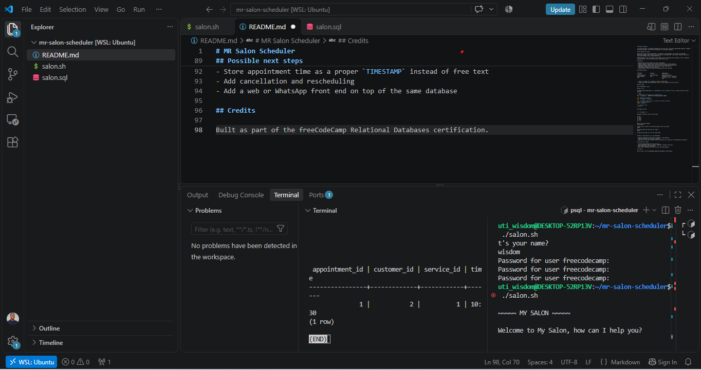

# MR Salon Scheduler



An interactive Bash + PostgreSQL command-line app that lets a salon take appointment bookings, remember returning customers, and store every booking in a relational database.

## The problem it solves

Small salons often track appointments in notebooks or chat messages. That causes lost bookings, duplicate customer records, and no easy way to see who booked what. This project replaces that with a structured database and a guided booking flow.

**Who benefits:** the salon owner (one reliable record of bookings) and customers (a fast, consistent booking process, and no re-entering their name every visit).

## Features

- Numbered service menu loaded live from the database
- Input validation: invalid or non-numeric service choices re-show the menu
- Customer lookup by phone number; new customers are registered automatically
- Appointment saved with links to the correct customer and service
- Confirmation message after each booking
- Single quotes in names and times are escaped before they reach SQL

## Database design

```
customers                services               appointments
-----------              -----------            ---------------
customer_id (PK)         service_id (PK)        appointment_id (PK)
phone (UNIQUE)           name                   customer_id (FK -> customers)
name                                            service_id  (FK -> services)
                                                time
```

- `phone` is unique, so a customer can never be duplicated.
- Foreign keys keep every appointment tied to a real customer and a real service.

## Tech stack

Bash, PostgreSQL (`psql`)

## How to run

The dump assigns ownership to a `freecodecamp` role, so create it first if it does not exist on your machine.

```bash
# 1. Create the role (skip if it already exists)
psql -U postgres -c "CREATE ROLE freecodecamp WITH LOGIN;"

# 2. Rebuild the database
psql -U postgres < salon.sql

# 3. Fix Windows line endings (if using WSL) and make executable
sed -i 's/\r$//' salon.sh
chmod +x salon.sh

# 4. Run the script
./salon.sh
```

## Example session

```
~~~~~ MY SALON ~~~~~

Welcome to My Salon, how can I help you?

1) cut
2) color
3) perm
4) style
5) trim
1

What's your phone number?
555-555-5555

I don't have a record for that phone number, what's your name?
Fabio

What time would you like your cut, Fabio?
10:30

I have put you down for a cut at 10:30, Fabio.
```

## What I would measure in a real deployment

- Bookings captured per week versus the paper or chat baseline
- Share of bookings from returning customers
- Duplicate or incorrect customer records (should be zero, thanks to the unique phone constraint)

## Possible next steps

- Prevent double-booking the same time slot
- Store appointment time as a proper `TIMESTAMP` instead of free text
- Add cancellation and rescheduling
- Add a web or WhatsApp front end on top of the same database

## Credits

Built as part of the freeCodeCamp Relational Databases certification.